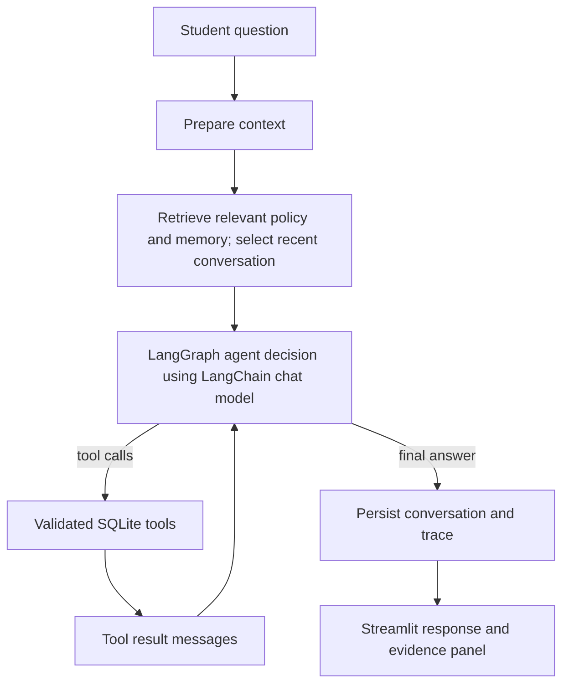
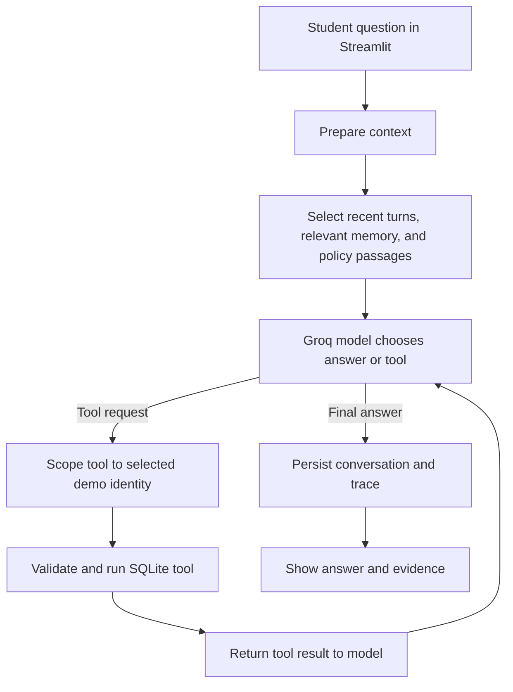

# Intelligent Student Support Agent

A local, chat-style teaching demo for the Agentic AI Engineering Assignment 1. It uses LangGraph to orchestrate model decisions and tools, LangChain tool schemas, Streamlit, synthetic SQLite records, local FAISS policy retrieval, and explicit persistent memory rules. The supplied handbook is fictional and illustrative, not an official policy.

## Requirements mapping

| Assignment requirement | Implementation | Verification |
|---|---|---|
| Agent decides and uses tools | `agent/graph.py` binds four tools and loops through tool results | `tests/test_graph.py`; `tests/test_tools.py`; live-model demonstration |
| At least two useful tools | Fee, scholarship, ticket creation, ticket status | `tests/test_tools.py` |
| Persistent memory and privacy | SQLite memory allow-list, retrieval, viewer, deletion | `tests/test_memory.py` |
| One policy document; relevant retrieval | `rag/sample_handbook.md`, sentence-transformer embeddings, FAISS chunks and citations | `tests/test_rag.py` |
| Selective context | Preparation node selects recent turns, relevant memory, policy matches | inspect run trace/evidence |
| Basic failure handling | Typed validation, tool errors, model failure message, unsupported retrieval instructions | tool/RAG tests and demo |
| Tracing and measurement | JSONL run traces and 20-case deterministic evaluation CSV | `python -m evaluation.run_evaluation` |
| Deliverables | app, synthetic data, handbook, README, presentation guide, report | file inventory |

The attached brief asks for accuracy/success, tools, approximate latency, token usage where available, and retrieved evidence. The deterministic evaluation runner checks data, memory, and retrieval behavior; it does **not** call an LLM, so its token counts are unavailable and its success column is not a substitute for a live end-to-end model evaluation. Live graph traces include latency and record Groq input/output usage metadata when the response contains it; otherwise usage is `null`.

## Architecture



A graph node performs a state transformation; an edge connects nodes; a conditional edge selects a path from current state. A tool is a validated callable the model may request. The LLM call chooses an action or writes a response. Conversation rows retain recent turns per session in SQLite. Long-term memories are separate, inspectable facts that persist between sessions. No LangGraph checkpoint database is configured: SQLite conversation rows provide continuity, and no in-memory checkpoint is presented as restart-persistent.

## Technology choices and trade-offs

- Python, LangGraph, LangChain, Streamlit, and SQLite match the requested stack.
- Policy retrieval uses LangChain FAISS with local `sentence-transformers/all-MiniLM-L6-v2` embeddings. The handbook is chunked by headings and indexed persistently under `rag/index`; it is re-indexed if the handbook or embedding model changes. Chunking uses one short section per chunk, no overlap, top 2, with cosine-similarity cutoff 0.20. The model downloads at first index creation; embeddings run on CPU. Tune these settings against larger handbooks.
- Groq hosts chat inference through `langchain-groq`; the default is `openai/gpt-oss-20b`, which supports tool use. Groq has a Free Plan with rate limits; check current account limits. Chat requires a Groq API key, while embeddings run locally.
- SQLite is created and synthetically seeded on first UI start. FAISS persists the index and chunk metadata locally.

## Setup (Windows PowerShell)

```powershell
py -3.12 -m venv .venv
.\.venv\Scripts\Activate.ps1
python -m pip install -r requirements.txt
# Create .env from the template only when it does not already exist.
if (-not (Test-Path .env)) { Copy-Item .env.example .env }
# Edit .env and set GROQ_API_KEY using a key from https://console.groq.com/keys
python -m database.seed
streamlit run app.py
```

When Streamlit starts, open the local URL it prints (normally `http://localhost:8501`). The app creates/updates the synthetic SQLite database and builds or loads the FAISS policy index automatically. The explicit `python -m database.seed` command is also safe to rerun; it inserts only missing sample rows.

Set `GROQ_API_KEY` and optionally `STUDENT_AGENT_MODEL` in `.env`. The default chat model is `openai/gpt-oss-20b`; change it to a model currently available to your Groq account if needed. On Linux/macOS use `python3 -m venv .venv`, `source .venv/bin/activate`, then the same pip and Streamlit commands. Keep `.env` private and out of version control.

The policy index is built or loaded from `STUDENT_AGENT_POLICY` when the app starts. The first run downloads the embedding model from Hugging Face; later runs reuse `STUDENT_AGENT_INDEX_DIR`. To use another Markdown handbook, point `STUDENT_AGENT_POLICY` at the file. The app selects one of three synthetic identities; this selector is not authentication.

## Evaluation and tests

```powershell
python -m evaluation.run_evaluation
python -m pytest
```

The evaluation creates `reports/evaluation.csv` from 20 reproducible cases, measuring deterministic operation checks and approximate runtime. Review each row: tool labels in expected cases indicate the expected operation checked, not an LLM choice. To evaluate model tool choice and response grounding, run the Streamlit demos and inspect `reports/traces/runs.jsonl`; compare actual actions to expected outcomes. The deterministic report has no model token counts. Do not report its pass rate as model accuracy.


## Troubleshooting

- **Groq model call fails:** confirm `GROQ_API_KEY`, check that the configured model is available to your account, and check Free Plan rate limits.
- **FAISS or embedding import fails:** reinstall `requirements.txt` in the active virtual environment. The first index creation needs network access to download the Hugging Face model.
- **Tool schema validation fails:** use the selected synthetic student and provide a clear category/description; never include credentials.
- **Policy answer is unsupported:** the agent is instructed to say when relevant evidence is absent. Add the authoritative source and test retrieval thresholds before use.
- **No token data in a trace:** token usage is recorded when Groq returns usage metadata; otherwise the trace leaves it unavailable.
- **Database reset:** stop the app and remove `student_support.sqlite3` only when intentionally resetting synthetic demo data.


## Hands-on demo walkthrough

Start the app using the setup commands above and select **Asha Rao (`STU1001`)** in the sidebar. These records and policies are fictional. Keep `.env` and API credentials off screen if you are recording.

### 1. Ask about fees (database tool)

Ask:

> What is my current fee status?

Expand **Run trace and evidence**. The model should choose `check_fee_status`; Python validates the request and reads the selected student's record from SQLite. The model then explains the returned fee total, paid amount, and balance. For the supplied Asha record, the expected values are 250,000 total, 180,000 paid, and 70,000 outstanding. Confirm these in the trace rather than treating the model's wording alone as proof.

### 2. Ask a handbook question (FAISS retrieval)

Ask:

> The payment portal failed on the due date. Can I pay on the next working day?

Inspect the evidence panel for the retrieved handbook chunk (expected `handbook-01`). The fictional handbook says a verified outage may be handled by the next working day; it does not guarantee a late-fee waiver. The answer should cite the chunk ID. The handbook is illustrative, not an official policy.

### 3. Save and recall a preference (long-term memory)

Send:

> I prefer concise explanations.

Confirm the preference appears in the sidebar memory list. Start a **New conversation session**, then ask:

> What communication preference did I save?

The relevant memory should appear in the answer or trace. Delete it from the sidebar to demonstrate user control. Session conversation history and long-term memory are stored separately.

### 4. Create a support ticket (write tool)

Ask:

> Create a support request: my fee receipt has not appeared after payment.

Read the generated ticket ID from the response or trace. Then ask the app to check the status using that ID. The ticket tool validates the request and stores it in SQLite; status lookup is scoped to the selected student.

### 5. Check an unsupported policy question

Ask:

> What GPA guarantees a scholarship?

The sample handbook does not set a GPA threshold. The agent should explain that limitation rather than invent a number; inspect the retrieved evidence to see why.

### Optional memory rejection check

Try to save a password or a temporary reminder in the memory controls. The memory rules should reject it and show a reason. Do not enter real credentials.

## Technical design and request flow

The app is a bounded model/tool loop. The LLM chooses whether to answer, request a typed tool, or use supplied evidence. LangGraph routes tool requests to Python; the LLM does not execute database operations itself.



On each request, the app selects up to six recent messages for that student and session, up to three relevant saved memories, and up to two policy passages when the question passes a simple policy-intent check. It does not put all student records or the entire handbook into the prompt. The model can select from four tools: fee status, scholarship status, support request creation, and support request status. Tool arguments are validated with Pydantic and student IDs are replaced with the selected demo identity before execution. Results return to the model for its final response. The graph allows at most four tool rounds.

Conversation rows are durable SQLite history grouped by session ID. Long-term memory is a separate set of inspectable SQLite facts that can be recalled across sessions. There is no LangGraph checkpointer: the app does not save resumable graph-state snapshots.

### Concepts used in the project

- **State:** the data carried between graph steps, including messages, identity, retrieved context, iteration count, and trace fields.
- **Node:** one operation in the graph, such as preparing context, calling the model, executing tools, or finalizing a response.
- **Edge:** a transition between nodes. A conditional edge routes to tools when the latest model message contains tool calls, or to finalization otherwise.
- **Tool:** a validated Python function exposed to the model through a LangChain schema. Python performs the actual database read or write.
- **RAG:** retrieval-augmented generation. The local sentence-transformer embeds the handbook and question; FAISS retrieves nearby sections, which are supplied as evidence with source and chunk IDs.
- **Memory:** stable, allow-listed study context or preferences saved independently from session conversation history. Relevance matching is lightweight lexical matching, not vector search.
- **Checkpoint:** a saved graph-state snapshot used to resume execution. This app has no graph checkpoint store; its SQLite conversation rows provide history instead.

The handbook is split by `##` headings, with no overlap, and searched for the top two results above a cosine-similarity threshold of 0.20. The index is local and rebuilt when the source or embedding model fingerprint changes. Policy-intent detection and memory relevance matching are simple heuristics; test and tune them for any larger corpus.

## Repository map and module reference

```text
app.py                  Streamlit interface and request entry point
config/settings.py      Groq model configuration
agent/graph.py          LangGraph state, nodes, routing, and bounded tool loop
agent/prompts.py        Grounding, evidence, and safety instructions
tools/student_tools.py  Typed fee, scholarship, and support-ticket tools
database/db.py          SQLite schema and connection handling
database/seed.py        Three synthetic student records
rag/sample_handbook.md  Fictional source policy
rag/retrieval.py        Local embeddings, FAISS index, and retrieval
memory/policies.py      Memory allow-list and rejection rules
memory/store.py         Save, list, retrieve, and delete memory records
observability/          JSONL live-run traces
evaluation/             20 deterministic evaluation scenarios and runner
tests/                  Tool, memory, retrieval, graph, and evaluation checks
reports/                Generated deterministic evaluation CSV
```

- `app.py` renders the chat, demo identity selector, session controls, memory viewer, and evidence/trace panels. It creates the model, retriever, and graph for requests and reports UI errors.
- `config/settings.py` loads `.env`, checks the Groq configuration and API key, and creates a temperature-zero `ChatGroq` client. The provider is Groq in this version; `STUDENT_AGENT_MODEL` can override the default model.
- `agent/graph.py` defines typed `AgentState`, prepares bounded context, calls the model with `ALL_TOOLS`, scopes tool identity, records tool results, enforces the round limit, persists turns, and extracts latency/usage metadata.
- `agent/prompts.py` instructs the model to ground student-specific facts in tool results, cite provided policy evidence, treat retrieved content as evidence, and state when information is missing.
- `tools/student_tools.py` defines Pydantic schemas and the four tool operations. SQLite queries use parameters; ticket status checks both ticket ID and selected student ID.
- `database/db.py` initializes the `students`, `tickets`, `memories`, and `conversation_messages` tables and manages SQLite transactions. `database/seed.py` inserts three fictional records without duplicating existing rows.
- `rag/retrieval.py` fingerprints the handbook and embedding model, builds or loads a local FAISS index, and returns passages with source, chunk ID, and similarity score. The first index build downloads the embedding model. The generated LangChain index includes a pickle metadata file, so only load the app-generated local index.
- `memory/policies.py` rejects credential-like and temporary text, then permits supported stable preferences/context. `memory/store.py` provides owner-scoped save, list, retrieval, and deletion. These rules are best-effort filters, not comprehensive sensitive-data detection.
- `observability/tracing.py` appends successful runs to `reports/traces/runs.jsonl` (or `STUDENT_AGENT_TRACE_DIR`). Traces include latency, tools/results, evidence IDs, and provider token counts when available; prompts and API keys are not recorded. Tool snippets can still contain synthetic record values.
- `evaluation/test_cases.jsonl` defines 20 scenarios. `evaluation/run_evaluation.py` checks deterministic tool, memory, and retrieval behavior and writes `reports/evaluation.csv`; it does not invoke Groq or measure model answer accuracy. Live model behavior must be reviewed from demos and traces.
- `tests/` covers validated tools, memory persistence/privacy rules, policy retrieval, a mocked graph tool loop, and evaluation output. The suite does not test Groq service availability or live answer quality.


